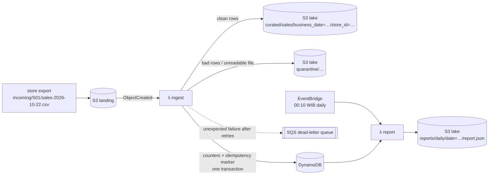

# Serverless ingest pipeline on AWS, built with Terraform


Retail stores drop their daily sales exports (CSV) into S3. A Lambda function
validates every row, writes clean data to a date-partitioned lake, quarantines
bad rows with a reason, and keeps per-day counters in DynamoDB. Failed
processing goes to an SQS dead-letter queue. Every night an EventBridge
schedule builds a report. Everything is defined in Terraform with one IAM role
per function scoped to exact prefixes. It runs and is tested on
[LocalStack](https://github.com/localstack/localstack), so you need no AWS
account to try it.



## What it does

`docs/demo-output.txt` shows one day uploaded to a fresh stack: four store files
and one broken file.

```
file                                status        ok  bad  reason
incoming/S01/sales-2026-10-22.csv   loaded      1200    0
incoming/S02/sales-2026-10-22.csv   loaded       800    0
incoming/S03/sales-2026-10-22.csv   loaded       950    0
incoming/S04/sales-2026-10-22.csv   partial      594    7
incoming/S05/export-2026-10-22.csv  rejected       0    0  missing columns: transaction_id, …
all processed in 6.5s
```

- **Rows are checked one by one.** Bad rows go to
  `quarantine/rows/…csv` with the line number and reason, for example
  `qty must be positive` or `sold_at has no time zone offset`. The rest of the
  file still loads.
- **Unreadable files are rejected whole.** A wrong header, a file that is not
  UTF-8, or a key outside `incoming/<STORE>/` all count. The file is copied to
  `quarantine/files/` with the reason in its metadata and adds nothing to the
  numbers.
- **Business dates are Jakarta days.** Tills send timestamps in UTC or local
  time. A sale at 00:30 WIB belongs to the next day, so one export can feed two
  `business_date` partitions, and the demo shows exactly that.
- **Retries and re-uploads count once.** S3 events arrive *at least once*. The
  DynamoDB transaction that adds the counters also writes a `(key, ETag)` marker
  with `attribute_not_exists`. A second delivery fails that condition, so
  nothing is added. Curated keys are deterministic, so rewriting them changes
  nothing.
- **Data problems and system failures are kept apart.** Bad data is quarantined
  and the function *succeeds*. Anything else raises: an object deleted before
  processing, a throttle or a bug. Lambda then retries and finally parks the
  event in the DLQ, from which it can be replayed.
- **There is a daily report.** EventBridge `cron(10 17 * * ? *)` is 00:10 in
  Jakarta. It reports the previous day's sales per store and that day's ingest
  health (files by status, rows quarantined, rejected files with reasons).
  Invoking it with `{"date": "YYYY-MM-DD"}` reruns any day.

## Infrastructure

| file | resources |
|---|---|
| `modules/pipeline/storage.tf` | landing + lake buckets (public access blocked, SSE, 30-day expiry on raw uploads), S3 → Lambda notification, DynamoDB single table (on-demand, PITR), SQS DLQ |
| `modules/pipeline/functions.tf` | two Lambdas (Python 3.12, no dependencies beyond boto3), log groups with retention, async retry config, EventBridge rule + target, invoke permissions scoped by source ARN/account |
| `modules/pipeline/iam.tf` | one role per function |
| `envs/local` | the module against LocalStack (`ap-southeast-3`, retries 0 so tests do not wait for backoff) |
| `envs/aws` | the same module for a real account, with a commented S3 backend |

The ingest role can only:

| action | resource |
|---|---|
| `s3:GetObject` | `landing/incoming/*` |
| `s3:PutObject` | `lake/curated/*`, `lake/quarantine/*` |
| `dynamodb:PutItem`, `UpdateItem` | the pipeline table |
| `sqs:SendMessage` | the DLQ |
| `logs:CreateLogStream`, `PutLogEvents` | its own log group |

The report role can only `Query` the table, `PutObject` to `lake/reports/*`
and write its own logs. No wildcard actions, no `*` resources. A test asserts
this.

## Run it

Requires Docker, Terraform ≥ 1.6 and Python 3.12.

```bash
python -m venv .venv && .venv/bin/pip install -r requirements-dev.txt
PATH=$PWD/.venv/bin:$PATH ./scripts/demo.sh        # LocalStack up, apply, upload a day, report
pytest -v tests                                     # 19 unit + 10 integration tests
docker compose down                                 # LocalStack keeps nothing on disk
```

## Tests

`tests/test_validate.py` covers the validation rules without AWS: every
rejection reason, the BOM/case/whitespace in headers, ragged rows, files that
are not UTF-8, and the Jakarta-day boundary.

`tests/integration/test_pipeline.py` runs against the applied stack, and every
assertion compares with the expected result produced by the data generator
(`tools/sample_data.py`):

- the counters per business date and store equal the generator's truth, to the rupiah;
- the curated partitions hold exactly the valid rows, with a single date per partition;
- the 7 injected defects end up in quarantine, each with its reason;
- re-uploading identical bytes returns `duplicate` and the counters do not move;
- a broken file is rejected whole and quarantined;
- an event for an object that no longer exists ends up in the DLQ;
- a scheduled-shaped event reports the right day, and the report totals equal the counters;
- the EventBridge rule targets the report Lambda at 00:10 WIB;
- the IAM policies grant only the actions and prefixes in the table above.

CI runs `terraform fmt`/`validate` for both environments, then brings up
LocalStack, applies, and runs all the tests and the demo.

## Limits, stated plainly

- **IAM is checked statically, not enforced.** LocalStack community does not
  enforce IAM, so a policy that is too *narrow* would only show up on real AWS.
  The test checks the policies are not too *broad*.
- **The code has not been applied to a real AWS account.** `envs/aws` passes
  `terraform validate` in CI. On real AWS a missing object returns
  `AccessDenied` rather than `NoSuchKey`, because the role has no
  `s3:ListBucket`. Either way the event goes to the DLQ.
- **Corrections add, they do not replace.** A store re-sending a *changed* file
  under the same key has a new ETag and is counted as additional sales. Real
  corrections need replace semantics: per-file contributions and removal of the
  old curated object. That is not built.
- **Curated data is gzip CSV, not Parquet.** This keeps the Lambdas
  dependency-free. Glue and Athena on top would be the next step, but they are
  LocalStack Pro only, so they are left out rather than shown untested.
- **One file must fit in memory.** The limit is 50 MB, and one file may span at
  most 90 business dates because a DynamoDB transaction holds at most 100
  items. Larger exports would need streaming or multipart processing.
- LocalStack is pinned to 4.14.0, the last community image that starts without
  an auth token.
